I'm Henry, a full-stack developer in Melbourne. I take products from a page of notes to something real people use: the database, the AWS plumbing, the app, and the landing page that sells it. Right now that's **[HeadsUp](https://headsup.rsvp)**, an RSVP app in open beta across Australia, **[Yeslane](https://yeslane.app)**, a client portal for marketing agencies, and **[yaysheet](https://yaysheet.app)**, interactive quotes your clients say yay to.

## Stuff I've shipped

  
  
  
  

- **[HeadsUp](https://headsup.rsvp)** turns any plan into an invite page sent by text. Guests RSVP with no app and no account, and the host sees who's in, guest by guest. Waitlist to open beta in three months.
- **[Yeslane](https://yeslane.app)** gives small agencies one branded place for approvals, chat, files, meetings and reports. Early access is open.
- **[yaysheet](https://yaysheet.app)** turns a quote into an interactive page sent as a link. Clients pick between options, ask about any line and accept in a tap, and you see every open and click. Coming soon, with a list to join.
- **[Scaffy CMS](https://henners.io/blog/introducing-scaffy/)** is an MIT-licensed headless CMS: define schemas in TypeScript, deploy once into your own AWS account. Paused while HeadsUp ships, with the whole build written up.

## How I work

  

## The stack I actually ship with

  

## Fresh off the workbench

- [HeadsUp, three months on: from a waitlist to open beta](https://henners.io/blog/headsup-waitlist-to-open-beta/)
- [Introducing HeadsUp: invite pages that get everyone there](https://henners.io/blog/introducing-headsup/)
- [One schema, two jobs: generating runtime validation from your types](https://henners.io/blog/one-schema-two-jobs/)

More on **[henners.io/blog](https://henners.io/blog)**.

 

Or connect on <a href="https://www.linkedin.com/in/henners-io/"><b>LinkedIn</b></a>.

Art drawn by <a href="scripts/build.py"><code>scripts/build.py</code></a> in the look of <a href="https://henners.io">henners.io</a>.

